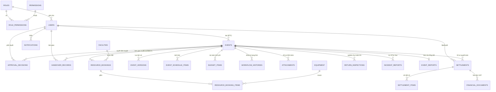

# EVENTFLOW — CƠ SỞ DỮ LIỆU & PHÂN QUYỀN HỆ THỐNG (DATABASE & RBAC)

Hệ thống quản lý quy trình tiếp nhận, xét duyệt và cấp phép tổ chức sự kiện tại **Trường Đại học Kinh tế – Đại học Đà Nẵng (DUE)**.

---

## 1. Cấu trúc Thư mục Database

```text
eventflow/
└── database/
    ├── schema.sql                   # Mã nguồn tạo toàn bộ 23 bảng, khóa ngoại, chỉ mục & ràng buộc
    ├── rbac_permissions_matrix.sql  # Danh mục 6 vai trò, 30+ quyền hạn & ma trận ánh xạ quyền
    ├── seed_data.sql                # Dữ liệu mẫu khởi tạo: 13 tài khoản DUE, 6 hội trường, 5 thiết bị
    └── README.md                    # Tài liệu đặc tả cơ sở dữ liệu và hướng dẫn vận hành
```

---

## 2. Sơ đồ Thực thể Quan hệ (ER Diagram)



---

## 3. Ma trận Phân quyền theo Vai trò (RBAC Permissions Matrix)

Hệ thống phân quyền theo mô hình **Role-Based Access Control (RBAC)** với 6 vai trò nghiệp vụ:

| Mã Quyền hạn (Permission) | Mô tả Nghiệp vụ | ADMIN | BTC | BCN Khoa | Đoàn Trường | CSVC | KHTC |
|---|---|:---:|:---:|:---:|:---:|:---:|:---:|
| **EVENT:CREATE** | Tạo mới hồ sơ sự kiện 5 bước | ✅ | ✅ | ❌ | ❌ | ❌ | ❌ |
| **EVENT:VIEW_OWN** | Xem hồ sơ do đơn vị mình phụ trách | ✅ | ✅ | ❌ | ❌ | ❌ | ❌ |
| **EVENT:VIEW_FACULTY** | Xem tất cả sự kiện thuộc Khoa | ✅ | ❌ | ✅ | ❌ | ❌ | ❌ |
| **EVENT:VIEW_ALL** | Xem toàn bộ hồ sơ trong toàn trường | ✅ | ❌ | ❌ | ✅ | ✅ | ✅ |
| **EVENT:EDIT_DRAFT** | Chỉnh sửa hồ sơ ở trạng thái nháp/cần sửa | ✅ | ✅ | ❌ | ❌ | ❌ | ❌ |
| **EVENT:SUBMIT** | Nộp hồ sơ xét duyệt chính thức | ✅ | ✅ | ❌ | ❌ | ❌ | ❌ |
| **EVENT:CANCEL** | Hủy bỏ sự kiện trước giờ G | ✅ | ✅ | ❌ | ❌ | ❌ | ❌ |
| **APPROVAL:KHOA_REVIEW** | BCN Khoa xét duyệt nội dung cấp 1 | ✅ | ❌ | ✅ | ❌ | ❌ | ❌ |
| **APPROVAL:DOAN_REVIEW** | Đoàn Trường thẩm định điều kiện cấp 2 | ✅ | ❌ | ❌ | ✅ | ❌ | ❌ |
| **APPROVAL:ISSUE_PERMIT**| Ban hành Giấy phép tổ chức sự kiện | ✅ | ❌ | ❌ | ✅ | ❌ | ❌ |
| **APPROVAL:VIEW_AUDIT_LOG**| Xem tiến trình và lý do phản hồi | ✅ | ✅ | ✅ | ✅ | ✅ | ✅ |
| **FACILITY:VIEW_CALENDAR** | Xem lịch sử dụng hội trường & thiết bị | ✅ | ✅ | ✅ | ✅ | ✅ | ✅ |
| **FACILITY:REQUEST_BOOKING**| Đăng ký giữ chỗ cơ sở vật chất | ✅ | ✅ | ❌ | ❌ | ❌ | ❌ |
| **FACILITY:APPROVE_BOOKING**| CSVC xác nhận giữ chỗ chính thức | ✅ | ❌ | ❌ | ❌ | ✅ | ❌ |
| **FACILITY:REJECT_BOOKING** | Từ chối hoặc yêu cầu đổi phương án | ✅ | ❌ | ❌ | ❌ | ✅ | ❌ |
| **FACILITY:MANAGE_LIST** | Quản lý danh mục phòng & kiểm kê | ✅ | ❌ | ❌ | ❌ | ✅ | ❌ |
| **HANDOVER:SIGN_PRE_EVENT** | Ký biên bản bàn giao CSVC trước giờ G | ✅ | ❌ | ❌ | ❌ | ✅ | ❌ |
| **HANDOVER:RECEIVE_FACILITY**| Xác nhận tiếp nhận hiện trạng CSVC | ✅ | ✅ | ❌ | ❌ | ❌ | ❌ |
| **HANDOVER:INSPECT_RETURN** | Nghiệm thu và kiểm tra hoàn trả CSVC | ✅ | ❌ | ❌ | ❌ | ✅ | ❌ |
| **HANDOVER:LOG_INCIDENT** | Lập biên bản sự cố, hư hỏng thiết bị | ✅ | ❌ | ❌ | ❌ | ✅ | ❌ |
| **SETTLEMENT:CREATE** | Lập bảng kê chi phí thực tế & chứng từ | ✅ | ✅ | ❌ | ❌ | ❌ | ❌ |
| **SETTLEMENT:SUBMIT** | Nộp hồ sơ sang Phòng KHTC | ✅ | ✅ | ❌ | ❌ | ❌ | ❌ |
| **SETTLEMENT:VERIFY_DOCS** | Kiểm tra hóa đơn VAT và tính hợp lệ | ✅ | ❌ | ❌ | ❌ | ❌ | ✅ |
| **SETTLEMENT:APPROVE** | Phê duyệt thanh toán / Từ chối chi | ✅ | ❌ | ❌ | ❌ | ❌ | ✅ |
| **REPORT:SUBMIT** | BTC nộp báo cáo tổng kết sau sự kiện | ✅ | ✅ | ❌ | ❌ | ❌ | ❌ |
| **REPORT:APPROVE** | Đoàn Trường nghiệm thu báo cáo tổng kết | ✅ | ❌ | ❌ | ✅ | ❌ | ❌ |
| **REPORT:VIEW_ANALYTICS** | Xem biểu đồ thống kê KPI & đo lường | ✅ | ❌ | ✅ | ✅ | ✅ | ✅ |
| **USER:MANAGE** | Quản lý người dùng, đổi vai trò | ✅ | ❌ | ❌ | ❌ | ❌ | ❌ |
| **SYSTEM:CONFIG** | Cấu hình tham số hệ thống | ✅ | ❌ | ❌ | ❌ | ❌ | ❌ |

---

## 4. Danh sách 13 Tài khoản Mẫu Đã Tạo Sẵn

> **Mật khẩu chung cho tất cả tài khoản:** `123456`

| STT | Họ tên & Chức danh | Email Trường DUE | Email Demo | Vai trò | Đơn vị trực thuộc |
|:---:|---|---|---|:---:|---|
| 1 | **Quản Trị Hệ Thống DUE** | `admin@due.edu.vn` | `admin@eventflow.vn` | `ADMIN` | Trung tâm Công nghệ Thông tin DUE |
| 2 | **Nguyễn Văn An** | `btc@due.edu.vn` | `btc1@eventflow.vn` | `BTC` | CLB Tin học DUE (IT Club) |
| 3 | **Trần Thị Bình** | - | `btc2@eventflow.vn` | `BTC` | Liên Chi đoàn Khoa QTKD |
| 4 | **PGS.TS. Lê Văn Cường** | `bcn@due.edu.vn` | `bcnkhoa@eventflow.vn` | `BCN_KHOA` | Ban Chủ nhiệm Khoa QTKD |
| 5 | **ThS. Phạm Thị Dung** | `doantruong@due.edu.vn`| `doantruong@eventflow.vn` | `DOAN_TRUONG` | Văn phòng Đoàn Thanh niên - Hội SV |
| 6 | **Nguyễn Hữu Em** | `csvc@due.edu.vn` | `csvc@eventflow.vn` | `CSVC` | Phòng Cơ sở vật chất & Thiết bị |
| 7 | **Trần Văn Phúc** | `khtc@due.edu.vn` | `khtc@eventflow.vn` | `KHTC` | Phòng Kế hoạch - Tài chính |

---

## 5. Hướng dẫn Chạy File SQL Trực tiếp

### Cách A: Nạp vào PostgreSQL
```bash
# Tạo cơ sở dữ liệu
createdb -U postgres eventflow_db

# Nạp bảng và phân quyền
psql -U postgres -d eventflow_db -f database/schema.sql
psql -U postgres -d eventflow_db -f database/rbac_permissions_matrix.sql
psql -U postgres -d eventflow_db -f database/seed_data.sql
```

### Cách B: Nạp vào SQLite (Đang dùng trong Backend dự án)
```bash
sqlite3 backend/dev.db < database/schema.sql
sqlite3 backend/dev.db < database/rbac_permissions_matrix.sql
sqlite3 backend/dev.db < database/seed_data.sql
```

### Cách C: Sử dụng Prisma ORM có sẵn trong Backend
```bash
cd backend
npx prisma db push
npx tsx prisma/seed.ts
```
